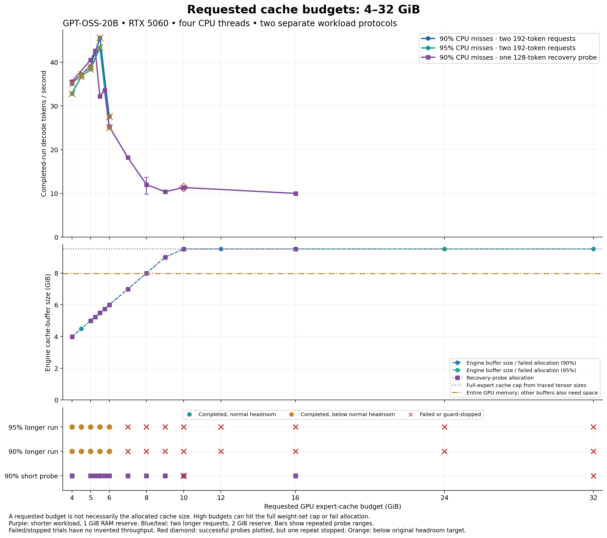

# Sweet-spot search — Experiment 002, second phase

Requested after the [primary series](../REPORT.md) finished, with requests to check falloff, look for a later recovery, and provide graphs.

**Complete.** Broad sweeps, recovery probes, three fresh-prompt validation rounds, answer checks and graphs are saved. The primary report remains separate.

Start with the [final report](REPORT.md). The selected tradeoff is **5 GiB cache, four CPU threads, 90% of cache misses on the CPU, mmap loading**: 43.14 decode tokens/s and 3.530 seconds mean complete 128-token request in validation. It is within 2.54% of the fastest validated decode setting (5.25 GiB), and all six normal-reasoning checks passed.

The 4–32 GiB requests exposed a pronounced falloff after the useful 5–5.25 GiB region. Shorter probes continued beyond earlier stops; they did not establish a competitive later recovery. Above about 9.52 GiB, this model/runtime's full-expert buffer cap prevents larger requests from becoming distinct effective cache sizes.



- [Fresh-prompt validation graph](graphs/validation.png).
- [Detailed cache curves and headroom](graphs/cache-curves.png).
- [CPU thread and miss-share graphs](graphs/cpu-settings.png).
- [Machine-readable selection](selection.json), [answer checks](quality.json), and [955 evidence checks](verification.json).

PNG and SVG versions plus the underlying JSON are saved under `graphs/`.

This phase varies cache size, CPU miss share and thread count. It uses two new tuning prompts, then three repeated rounds on four further validation prompts. After the user explicitly expanded the range to **4–32 GiB**, the final performance choice was defined as the smallest tested cache within 5% of the fastest setting completing all three validation rounds, with fewer threads breaking ties. The original 512 MiB GPU / 3 GiB system-RAM margin defines a separately reported conservative alternative; it does not veto the requested wider experiment.

The initial search covered 512–4,608 MiB, CPU shares through 100%, and thread counts through 16. That initial cache bound was too narrow for the user's intended investigation. A subsequent sweep explicitly attempted requested budgets of **4, 4.5, 5, 5.5, 6, 7, 8, 9, 10, 12, 16, 24 and 32 GiB**, at both 90% and 95% CPU miss shares. It allowed low GPU headroom, used a 180-second per-run cap, and retained a 2 GiB system-RAM reserve.

After a measured speed drop and reserve-triggered stops, a shorter recovery probe used one 128-token request, a 90-second cap and a 1 GiB RAM reserve. It reached beyond the earlier stop and repeated the apparent low point and recovery, while also refining 5–6 GiB in quarter-GiB steps. Its workload and reserve differ from the two-192-token-request sweep: their rates must not be pooled as if they were identical trials.

Requested budget, actual allocated buffer, failed allocation size and inference outcome are recorded separately. GPT-OSS-20B's full expert bank caps the engine buffer near **9.52 GiB** with these settings. A 32 GiB request therefore does not mean that a 32 GiB cache was allocated. Failed or guard-stopped trials do not receive invented zero-speed values.

Possible dips followed by recoveries are screened at 5% and repeated before interpretation. All trials remain in `../runs/sweet-*`, including failures and headroom exclusions. Single-run fluctuations are not automatically architectural effects.

## Evidence

- `plan.json`, `calibration.json`: initial adaptive sweep.
- `curve-plan.json`, `curve-thread-choice.json`, `curve-calibration.json`: wider curves.
- `turning-points.json`, `curve-repeats.json`, `curve-aggregates.json`: candidate turning points and repeats.
- `validation-plan.initial.json`: original selection, retained before the expanded search.
- `wide-range-plan.json`, `wide-range.json`: all 26 explicit 4–32 GiB budget/share attempts, including allocation and reserve failures.
- `recovery-plan.json`, `recovery-probe.json`, `recovery-aggregates.json`: shorter probes and repeat evidence beyond the drop.
- `validation-plan.json`, `validation.json`, `selection.json`: fresh-prompt validation and selection.
- `quality.json`: normal-reasoning checks for the selected setting.
- `graphs/`: PNG, SVG and underlying JSON for cache, CPU-setting and validation graphs.

## Commands

From the repository root, in a fresh reproduction checkout or with unused labels:

```powershell
.\.venv\Scripts\python.exe experiments/002-real-moe-routing/scripts/sweet_spot.py tune
.\.venv\Scripts\python.exe experiments/002-real-moe-routing/scripts/curve_search.py
.\.venv\Scripts\python.exe experiments/002-real-moe-routing/scripts/wide_cache.py
.\.venv\Scripts\python.exe experiments/002-real-moe-routing/scripts/recovery_probe.py
.\.venv\Scripts\python.exe experiments/002-real-moe-routing/scripts/prepare_validation.py
.\.venv\Scripts\python.exe experiments/002-real-moe-routing/scripts/sweet_spot.py validate
.\.venv\Scripts\python.exe experiments/002-real-moe-routing/scripts/plot_results.py
.\.venv\Scripts\python.exe experiments/002-real-moe-routing/scripts/verify_sweet.py
```

Run sequentially. Do not benchmark multiple GPU configurations concurrently. Results are specific to the pinned model/runtime, loading mode, context, workload and current machine.
