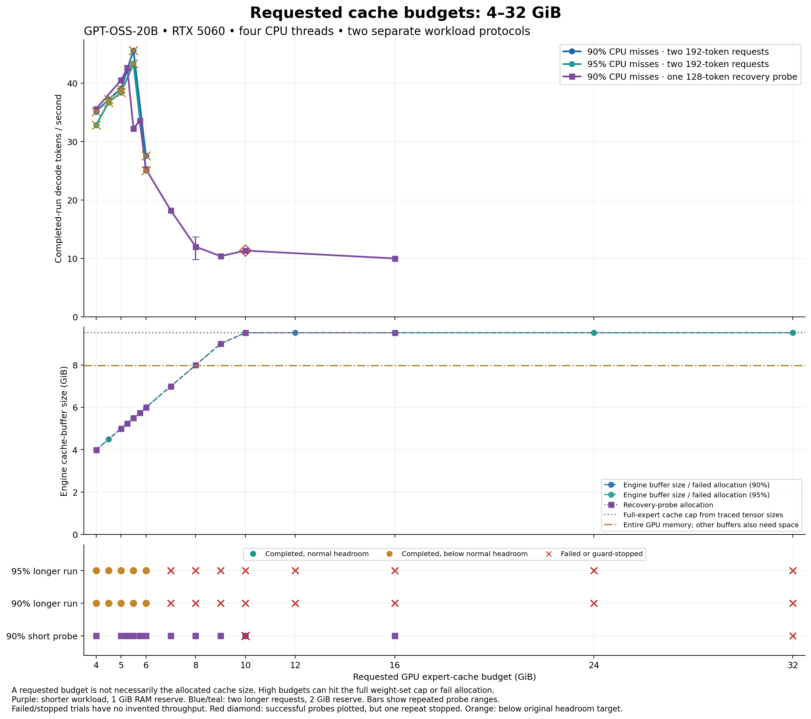
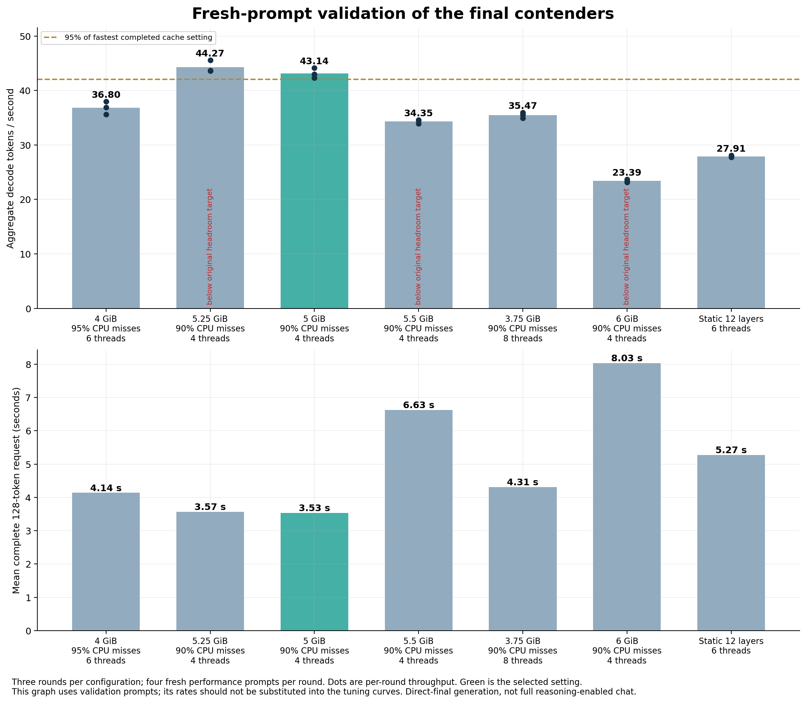
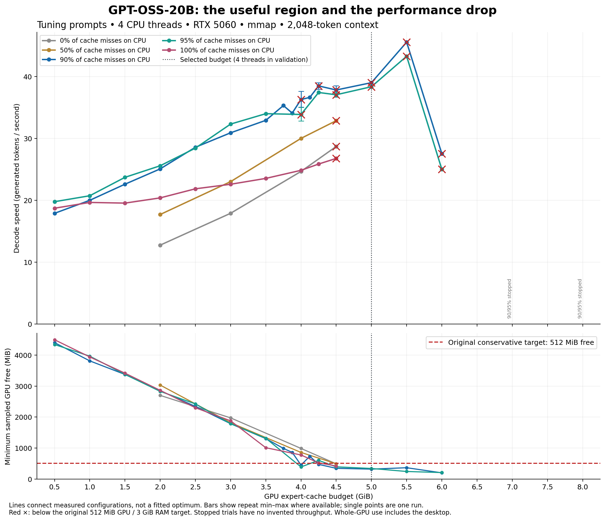

# Cache sweet spot: measured 4–32 GiB requests

Completed November 17, 2026. This is the separately authorized second phase of [Experiment 002](../../README.md); the [primary comparison](../REPORT.md) remains separate.

## Finding

The best measured tradeoff is **5 GiB requested expert cache, four CPU threads, and 90% of cache misses computed on the CPU**, using memory-mapped loading. In three fresh-prompt validation rounds, this reached **43.14 decode tokens/s**, with **3.530 seconds** mean complete-request latency for 128 generated tokens. The per-round decode rates were 42.30, 44.16 and 43.01 tokens/s.

The fastest validated decode setting was 5.25 GiB at 44.27 tokens/s. The 5 GiB choice was only 2.54% slower, used less cache, and had a slightly lower observed mean request latency. That 1.1% latency difference is small and is not established as statistically significant. The predefined choice was the smallest tested cache within 5% of the fastest candidate completing all three validation rounds.

The broader range was actually attempted: **4, 4.5, 5, 5.5, 6, 7, 8, 9, 10, 12, 16, 24 and 32 GiB**, each at both 90% and 95% CPU miss shares. Shorter follow-up probes refined 5–6 GiB and tested beyond the first slowdown and reserve-triggered stops. A substantial falloff was confirmed. Small later upticks occurred, but no repeatable, competitive higher-cache peak was established.

All sizes use binary units: 1 GiB = 1,024 MiB = 1,073,741,824 bytes. These are **expert-weight cache budgets**, not KV-cache sizes, total model sizes, or system-RAM allocations.

## Full requested range



[Vector SVG](graphs/wide-range.svg) · [Underlying graph data](graphs/graph-data.json)

Blue and teal use two 192-token requests. Purple uses a separate one-128-token recovery protocol. Their absolute rates must not be pooled into one ranking. Missing throughput denotes a failed or stopped run, never an invented zero.

| Requested budget | Two × 192 tokens, 90% CPU | Two × 192 tokens, 95% CPU | Short recovery probe, 90% CPU |
|---|---:|---:|---|
| 4 GiB | 35.08 tok/s | 32.83 tok/s | 35.58 tok/s |
| 4.5 GiB | 37.20 | 36.69 | Not tested |
| 5 GiB | 39.03 | 38.38 | 40.26–40.78, three completions |
| 5.25 GiB | Not tested | Not tested | 42.24–43.01, three completions |
| 5.5 GiB | **45.58** | **43.31** | 32.24 |
| 5.75 GiB | Not tested | Not tested | 33.54 |
| 6 GiB | 27.55 | 25.02 | 25.26 |
| 7 GiB | 2 GiB RAM reserve stop | 2 GiB RAM reserve stop | 18.20 |
| 8 GiB | 2 GiB RAM reserve stop | 2 GiB RAM reserve stop | 9.79–13.66, three completions |
| 9 GiB | Initialization failure | Initialization failure | 10.37 |
| 10 GiB | Allocation failure | Allocation failure | 11.27–11.37, two completions; one 1 GiB reserve stop |
| 12 GiB | Initialization failure | Initialization failure | Not tested |
| 16 GiB | Compute-buffer allocation failure | Initialization failure | 9.98 |
| 24 GiB | Initialization failure | Compute-buffer allocation failure | Not tested |
| 32 GiB | Compute-buffer allocation failure | Cache allocation failure | 1 GiB RAM reserve stop |

The 5.5 GiB setting won the longer exploratory sweep, so it was retained for final validation even though the short probe disagreed. On four fresh prompts it repeatedly fell to 34.35 tokens/s. This workload/resource sensitivity is a reason to retain repeated validation, not to discard the earlier observation.

The first recovery sequence appeared to rise from 9.79 tokens/s at 8 GiB to 11.37 at 10 GiB. Repeating those settings changed the 8 GiB result to 13.38 and 13.66, while completed 10 GiB results stayed near 11.3 and one attempt stopped. There is also a small observed rise from 9 to 10 GiB, but the 9 GiB point was not repeated. These observations do not establish a stable recovery caused by cache capacity. None approaches the 5–5.25 GiB region.

## Requested versus effective capacity

The engine reports cache buffers of approximately 5,118.37 MiB at a 5 GiB request, 5,370.50 at 5.25 GiB, 5,622.64 at 5.5 GiB, and 6,139.52 at 6 GiB. Slots contain whole experts, so allocation need not equal the requested budget exactly.

The traced expert tensors total **13,219,200 bytes per layer/expert pair**. There are 24 layers × 32 experts = 768 pairs. With the five reserved slots used in this configuration, the maximum cache buffer is:

```text
(768 + 5) × 13,219,200 = 10,218,441,600 bytes
                        = 9,745.0653 MiB
                        ≈ 9.5167 GiB
```

Requests of 10, 12, 16, 24 and 32 GiB therefore reach the same full-expert bank cap when allocation is attempted. **A 32 GiB request did not allocate a 32 GiB cache.** The records separately retain requested budget, reported cache buffer, failed allocation size and inference outcome. For example, a reported cache allocation followed by a failed 168.48 MiB compute buffer is not a successful inference run.

This cap is a property of this model/runtime configuration. The experiment cannot test a second capacity-driven peak between 10 and 32 GiB because this checkpoint has no additional experts to fill that capacity. It does test how the engine handles those explicit requests. Engine buffer size is also not proof that the entire buffer remained physically resident in dedicated VRAM.

The slowdown and failures are consistent with memory pressure, but the experiment did not measure physical PCIe traffic, GPU residency migration, or page faults. It does not isolate the operating-system or driver mechanism, and a configured RAM-reserve stop is not proof of an intrinsic physical limit.

## Fresh-prompt validation

Seven configurations each completed three process repetitions, with four fresh prompts per repetition: **21 processes and 84 fixed-length requests**. Prompt topics were chemistry, grammar, introductory statistics and reading supplied study notes. Configuration order and prompt order rotated; three rounds do not fully balance all seven order positions. Each process had a standardized 32-token warm-up. Prompt reuse was disabled, and expert-cache state persisted between requests within a process.

| Configuration | Decode tok/s | Per-round range | Mean request | Mean first-token latency | Minimum sampled GPU free |
|---|---:|---:|---:|---:|---:|
| 3.75 GiB, 90% CPU misses, 8 threads | 35.47 | 34.96–35.95 | 4.309 s | 0.728 s | 1,740 MiB |
| Original 4 GiB, 95% CPU misses, 6 threads | 36.80 | 35.61–37.96 | 4.137 s | 0.685 s | 1,513 MiB |
| **5 GiB, 90% CPU misses, 4 threads** | **43.14** | **42.30–44.16** | **3.530 s** | **0.586 s** | **618 MiB** |
| 5.25 GiB, 90% CPU misses, 4 threads | 44.27 | 43.59–45.56 | 3.569 s | 0.700 s | 233 MiB |
| 5.5 GiB, 90% CPU misses, 4 threads | 34.35 | 33.95–34.60 | 6.625 s | 2.927 s | 83 MiB |
| 6 GiB, 90% CPU misses, 4 threads | 23.39 | 23.13–23.72 | 8.033 s | 2.603 s | 292 MiB |
| Static 12-layer offload, 6 threads | 27.91 | 27.73–28.12 | 5.270 s | 0.718 s | 1,653 MiB |

On these identical validation prompts, the selected configuration increased decode throughput **17.2% over the original hybrid setting** and **54.6% over static offload**. Complete-request latency decreased 14.7% and 33.0%, respectively. The improvement over the original setting combines cache size, CPU miss share and thread-count changes; it is not attributable solely to cache size.



[Vector SVG](graphs/validation.svg) · [Selection and per-round metrics](selection.json)

The performance-first selection rule was recorded before fresh validation, after the user expanded the range. The original criterion requiring at least 512 MiB sampled GPU free and 3 GiB system RAM was retained as a separate conservative comparison. Both rules selected 5 GiB in final validation. That setting had at least 4.72 GiB available system RAM in those rounds.

This is not a guaranteed reserve under every desktop load: earlier 5 GiB short probes reached only 407 MiB free GPU memory. The original 4 GiB reference retained more margin in validation. Background application use was neither stopped nor controlled; all headroom numbers are sampled whole-machine observations. Earlier plans with the original eligibility rule are preserved, and `recovery-plan.json` records the selection revision.

## CPU and smaller-cache results

The earlier adaptive search covered 0.5–4.5 GiB, thread counts 2, 4, 6, 8, 10, 12 and 16, and CPU miss shares including 0%, 50%, 75%, 90%, 95% and 100% across selected budgets. This is not a full Cartesian search.

The 4 GiB/95% thread screen plateaued around 4–8 threads, with lower performance at 16 threads. Four threads were chosen for the broad cache sweep as the fewest within 3% of the best screen result. At the tested budgets, 90% CPU miss share generally outperformed 95%, and changing to 100% caused a large drop. More CPU work and more threads were not monotonically better.

The term CPU miss share applies to cache misses, not to 90% of all model computation. Cached expert work and the rest of the graph have their own execution placement.



[CPU settings graph](graphs/cpu-settings.png) · [Detailed curves SVG](graphs/cache-curves.svg) · [CPU settings SVG](graphs/cpu-settings.svg)

## Protocol, quality and limitations

Hardware and software stayed pinned to GPT-OSS-20B MXFP4, llama.cpp b12359, the RTX 5060, i5-14400F, 32 GiB installed RAM and Windows 11. Context was 2,048 tokens, batch and microbatch 256, one sequence, flash attention enabled, mmap loading, fixed temperature zero and seed 1729. The full identities and hashes are in [setup evidence](../setup/environment.json) and the [experiment protocol](../../PROTOCOL.md).

The broad sweep used two 192-token tuning requests, a 180-second process limit and a 2 GiB available-RAM floor. The recovery probe used one 128-token request, 90 seconds and a 1 GiB floor. Final validation used four new 128-token requests, 180 seconds and a 1 GiB floor. Wide, recovery and validation runs had no minimum free-GPU veto. No system/pagefile settings were changed, and only each runner's own server process was terminated.

Decode throughput is total timed decode steps divided by total engine decode seconds, following the engine's `predicted_n - 1` convention. Request latency includes streaming HTTP completion but excludes startup, prior warm-up and template formatting. Performance prompts explicitly selected the final-answer channel and ignored EOS to obtain fixed output counts. They are not measurements of full reasoning-enabled conversations.

After selection, all six normal-reasoning answer checks passed, with a mean completed-answer time of **1.946 seconds**. Responses are preserved in [the selected quality run](../runs/sweet-quality-selected/run.json). These are six narrow checks, not broad educational-quality certification. The earlier primary direct-final test still retains its shared algebra error; later successful reasoning checks do not erase it.

The phase contains 18 initial calibration attempts, 43 curve attempts, four curve repeats, 26 broad-range attempts, 20 shorter recovery attempts, 21 validation processes and one selected-quality process: **133 process trials**, including failures. Repeated extrema and three final rounds constrain the recommendation, but there are no formal confidence intervals, exhaustive optimum proof, long-context tests, concurrent-user tests or sustained multi-hour soak tests.

The useful conclusion is a bounded working profile and a measured failure region. It does not establish GPT-OSS-120B feasibility, SSD streaming beyond host RAM, a universally best cache policy, or exact numerical equivalence between execution paths. A future experiment could test this profile over longer conversations and varying background memory load, then isolate memory residency and transfer behavior around the 5–6 GiB drop.

## Reproduction and evidence checks

The [phase README](README.md) lists the complete sweep commands and JSON evidence. To repeat only the selected setting on the saved validation prompts with a new label, from the repository root:

```powershell
.\.venv\Scripts\python.exe experiments/002-real-moe-routing/scripts/benchmark.py my-selected-repeat --threads 4 --suite sweet-validation --load-mode mmap -- -ngl 99 -cmoe --moe-cache-mib 5120 --moe-cache-cpu-share 0.9
```

Five routing/parser/answer-check unit tests passed, as did [433 primary evidence checks](../verification.json) and [955 sweep evidence checks](verification.json). The sweep checks verify coverage through 32 GiB, source snapshot hashes, retained failures, raw timing arithmetic, exact output counts, disabled prompt reuse, fresh validation prompts and the selection rule. Four PNG/SVG graph pairs were rendered and visually inspected; their source data are retained. These checks validate the recorded experiment, not general model quality or deployment readiness.
